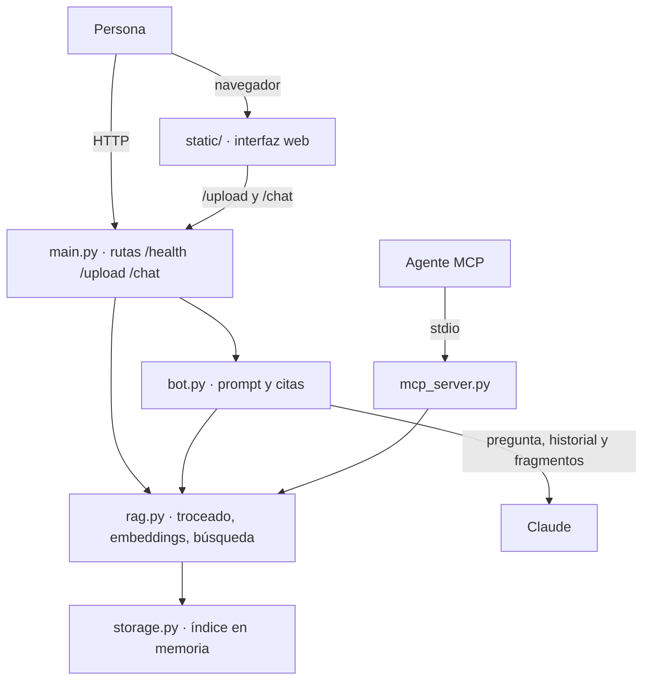
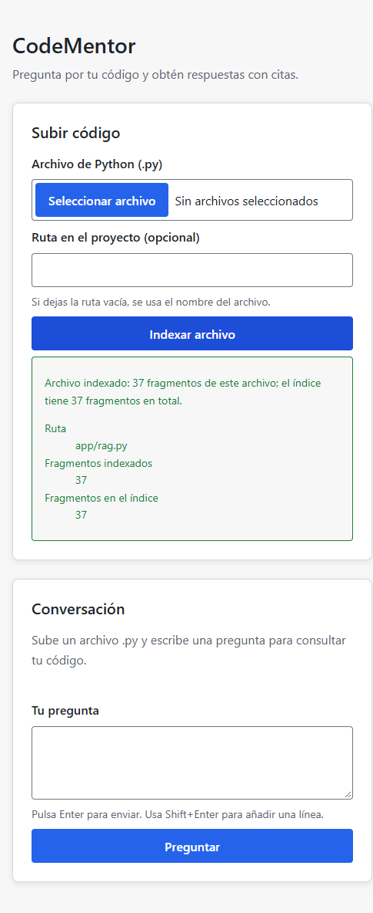
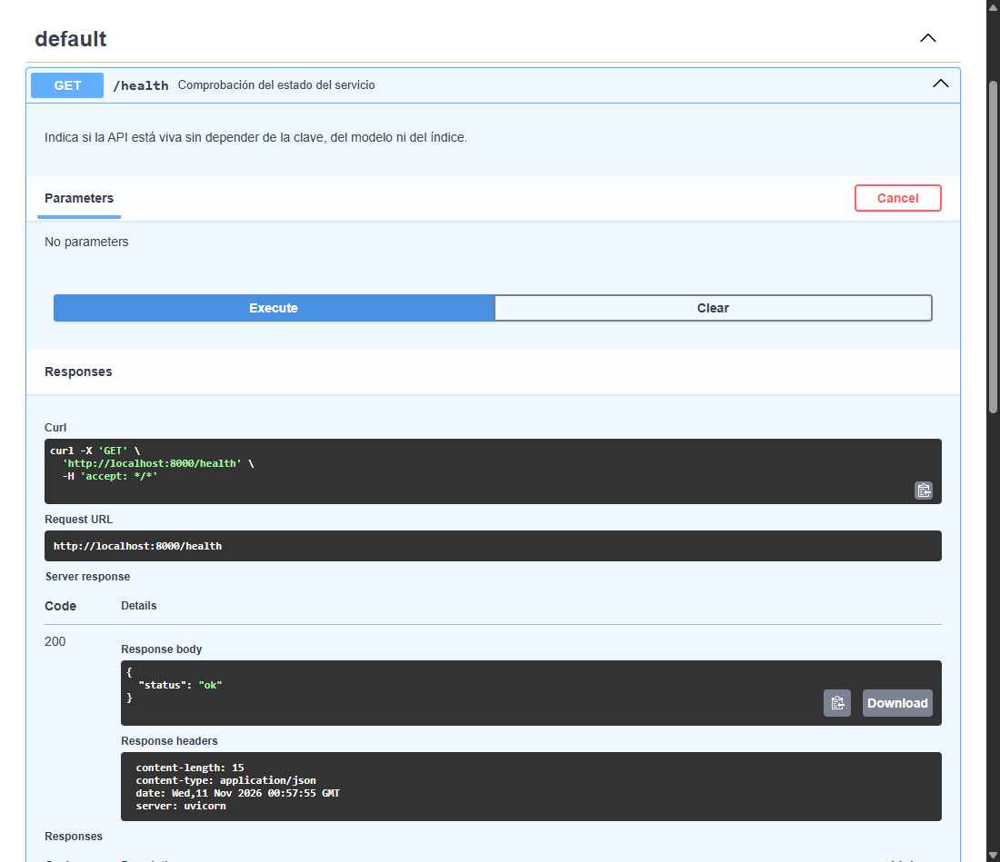

# CodeMentor

## Qué es CodeMentor y qué problema resuelve

CodeMentor es un asistente RAG que indexa archivos de Python y responde preguntas sobre el código citando el archivo, el símbolo y el rango de líneas de donde sale cada dato. Está pensado para orientarse rápido en un repositorio sin leerlo entero: subes un archivo `.py`, preguntas dónde está una función o cómo se calcula algo y recibes una respuesta respaldada por fragmentos concretos. Si la respuesta no está en el código indexado, el bot debe decir que no la encontró en lugar de inventarla.

**Estado (2026-11-10):** las specs 001 a 007 están implementadas y validadas. El GIF de demostración y la prueba manual del chat con una clave real siguen pendientes no bloqueantes, y el índice vive en memoria sin persistencia.

## Funcionalidades principales

- **Subida e indexado:** acepta archivos `.py`, los trocea por función, clase y bloque de módulo, y aplica un plan B por ventanas si el archivo no se puede analizar.
- **Búsqueda con embeddings:** representa los fragmentos con `paraphrase-multilingual-MiniLM-L12-v2` y los ordena por similitud coseno.
- **Chat con citas:** responde con Claude usando solo los fragmentos recuperados y muestra archivo, símbolo y líneas de cada cita.
- **Interfaz web:** permite subir un archivo y conversar desde el navegador, sin frameworks de frontend.
- **API HTTP:** expone `GET /health`, `POST /upload` y `POST /chat`.
- **Herramientas MCP:** publica `search_code` e `index_file` por stdio para que otro agente use la búsqueda y el indexado.

## Diagrama de arquitectura



El diagrama muestra las capas reales del sistema y que `mcp_server.py` consume `rag.py` sin pasar por HTTP. El índice es el mismo singleton en memoria de cada proceso.

## Requisitos previos

- **Python 3.12** y **pip**.
- **git**, para clonar el repositorio.
- **Conexión a internet** para instalar las dependencias y, la primera vez, descargar el modelo de embeddings.
- **Docker (opcional)**, solo si vas a usar el contenedor local en lugar de ejecutar la aplicación con Python.
- **Clave de Anthropic**, solo para el chat. Sin ella la aplicación arranca y el resto de funciones sigue disponible.

## Inicio rápido

Clona el repositorio y entra en la carpeta del proyecto:

```bash
git clone https://github.com/mariacamilazapata155-svg/CodeMentor.git
cd CodeMentor

# Crea y activa un entorno virtual
python -m venv venv
venv\Scripts\activate        # Windows
source venv/bin/activate     # Linux/macOS

# Instala las dependencias fijadas
pip install -r requirements.txt

# Crea la configuración local a partir del ejemplo
copy .env.example .env       # Windows
cp .env.example .env         # Linux/macOS

# Arranca la aplicación
uvicorn app.main:app
```

En otra terminal, comprueba que responde:

```bash
curl.exe http://localhost:8000/health   # PowerShell
curl http://localhost:8000/health       # Linux/macOS
```

La respuesta esperada es:

```json
{"status":"ok"}
```

La primera ejecución local descarga el modelo de embeddings y lo carga durante el arranque. Según la conexión, puede tardar varios minutos y `GET /health` no responderá hasta que termine el calentamiento; no es un fallo. Las siguientes ejecuciones usan la caché local.

Sin `ANTHROPIC_API_KEY`, la aplicación arranca, `/health` responde, `/upload` indexa archivos, las herramientas MCP funcionan y el contenedor local también arranca sin clave; solo el chat con respuestas de Claude queda desactivado. Cuando hay fragmentos relevantes indexados, `/chat` devuelve `503` con el mensaje literal `Falta la clave de acceso al modelo. Configúrala en la variable de entorno ANTHROPIC_API_KEY y vuelve a intentarlo.`, que indica cómo configurarla y no representa un fallo del producto.

En PowerShell, `curl` es un alias de `Invoke-WebRequest`; usa `curl.exe` para ejecutar el comando tal como se muestra.

## Ejemplos de uso

### API HTTP

Los ejemplos usan `curl.exe` y la continuación de línea de PowerShell; en Linux/macOS sustituye `curl.exe` por `curl` y los backticks por `\`.

```powershell
# Salud del servicio
curl.exe http://localhost:8000/health

# Subida con ruta explícita
curl.exe -F "file=@app/rag.py" -F "path=app/rag.py" http://localhost:8000/upload

# Subida sin path: la ruta efectiva es el nombre del archivo
curl.exe -F "file=@app/rag.py" http://localhost:8000/upload

# Archivo no permitido: debe devolver 400 invalid_extension
curl.exe -F "file=@README.md" http://localhost:8000/upload

# Chat con historial opcional (si se omite, se usa [])
curl.exe -X POST http://localhost:8000/chat `
  -H "Content-Type: application/json" `
  -d '{"message":"¿Dónde se calculan los embeddings?","history":[]}'
```

Resultados esperados:

- `GET /health` → `200` con `{"status":"ok"}`.
- `POST /upload` con `app/rag.py` y `path=app/rag.py` → `200` con `file_path: "app/rag.py"`, `chunks_indexed`, `total_chunks`, `used_windows` y un `message` de éxito. Los contadores dependen del archivo y del estado del índice.
- `POST /upload` con `app/rag.py` sin `path` → `200` con `file_path: "rag.py"`, porque la ruta efectiva es el nombre del archivo.
- `POST /upload` con `README.md` → `400` con `{"message":"Solo se aceptan archivos de Python (.py).","reason":"invalid_extension"}`.
- `POST /chat` sin clave, después de indexar `app/rag.py` y con una pregunta que recupere fragmentos → `503` con el mensaje de `missing_api_key` de la sección de inicio rápido.
- `POST /chat` con clave → `200` con `reply`, marcas `[Fn]` y `citations[]` con `number`, `file_path`, `symbol_name`, `start_line` y `end_line`; `reason` vale `null`. `history` es opcional.

Los resultados sin respuesta, como un índice vacío o una pregunta sin fragmentos relevantes, devuelven `200` con un `reason` propio; no son fallos HTTP.

### Interfaz web

Abre `http://localhost:8000`, sube `app/rag.py` y escribe `¿Dónde se calculan los embeddings?`. La respuesta debe mostrar las citas con archivo, símbolo y líneas. Si ya hay fragmentos relevantes y falta la clave, verás el aviso para configurarla; si no hay código indexado, verás el aviso para subir un archivo. Ninguno de los dos es un fallo de la página.

### MCP

```bash
npx @modelcontextprotocol/inspector python -m app.mcp_server
```

En el inspector:

1. Ejecuta `index_file` con `path: "tests/test_health.py"` y el contenido completo de ese archivo.
2. Ejecuta `search_code` con `query: "health"`.
3. El resultado debe incluir un bloque con `Ruta: tests/test_health.py`, `Símbolo: test_health_returns_ok` y su rango de líneas real (`13–18`).

El índice es propio de cada proceso: si buscas antes de indexar, verás el aviso de índice vacío, y si reinicias el servidor tendrás que volver a indexar en la misma sesión.

## Demo

Capturas tomadas de la aplicación en ejecución con `uvicorn app.main:app` en `http://localhost:8000`.

El GIF animado de 10 a 20 segundos queda pendiente: no se grabó una respuesta con citas porque no había una clave válida disponible. En lugar de publicar una imagen falsa, se muestran estas dos capturas reales del flujo; el GIF se añadirá cuando se pueda grabar la respuesta completa.

### Indexado desde la interfaz web



Subida de `app/rag.py` con la ruta `app/rag.py`: la interfaz confirma el archivo indexado, los 37 fragmentos del archivo y los 37 fragmentos del índice.

### API en marcha



`GET /health` ejecutado desde la documentación interactiva (`/docs`): responde `200` con `{"status":"ok"}` y las cabeceras de `uvicorn`.


## Uso con Docker

La imagen se construye en local y no se publica en ningún registro. El build necesita conexión a internet para instalar las dependencias y descargar el modelo de embeddings.

```bash
docker build -t codementor:local .
```

El tamaño real medido con `docker image inspect --format "{{.Size}}" codementor:local` es **10.920,74 MiB (11.451.221.098 bytes)**. La mayor parte corresponde a las dependencias de `sentence-transformers` y torch. Un segundo build del mismo commit reutiliza la caché y es mucho más rápido.

Ejecución sin clave:

```bash
docker run --rm -p 8000:8000 codementor:local
```

La aplicación queda en `http://localhost:8000`. Sin clave funcionan `/health`, la subida de archivos `.py` y el frontend; `/chat` devuelve `503` con el motivo `missing_api_key`.

Para el chat, pasa la clave solo en tiempo de ejecución y sustituye el marcador en tu terminal:

```bash
docker run --rm -p 8000:8000 -e ANTHROPIC_API_KEY=... codementor:local
```

El modelo ya está en la imagen, dentro de `/opt/models`, así que `docker run` no lo descarga. El arranque carga el modelo y `/health` responde después del calentamiento.

Para comprobar que no hay descarga en tiempo de ejecución, ejecuta el contenedor sin red y consulta la salud desde dentro, porque `--network none` no publica el puerto en el host:

```bash
docker run --rm --network none --name codementor-offline codementor:local
```

En otra terminal:

```bash
docker exec codementor-offline python -c "import urllib.request; print(urllib.request.urlopen('http://127.0.0.1:8000/health').read().decode())"
```

La respuesta esperada es `{"status":"ok"}`. El arranque offline puede mostrar reintentos de resolución de nombres de Hugging Face antes de completar; el modelo se carga desde la caché y no se descarga.

Límites: el contenedor no monta el código del usuario, no conserva el índice al detenerse y no escribe datos de la aplicación en el sistema de archivos del host. No hay autenticación, TLS ni persistencia; no lo expongas directamente a internet. El empaquetado es solo con el `Dockerfile` y la imagen no se publica en ningún registro.

## Decisiones y porqués

| Decisión | Motivo | Alternativa descartada |
|---|---|---|
| Capas `main.py → bot.py → rag.py → storage.py`, con `mcp_server.py` consumiendo `rag.py` | Cada capa se prueba y se cambia sin arrastrar las demás; MCP no depende de HTTP | Un módulo único o MCP pasando por la API |
| Troceado por función y clase con `ast`, bloque de módulo y plan B por ventanas | Las citas apuntan a símbolos y líneas reales; un archivo roto no se pierde | Trocear por párrafos o rechazar archivos no analizables |
| Embeddings normalizados y producto punto como similitud coseno, con umbral `0.30` | Búsqueda rápida y determinista sin un índice aproximado | Vectores sin normalizar o búsqueda por palabras clave |
| Citas construidas desde los resultados de la búsqueda, no desde el texto del modelo | Evita rutas, funciones y líneas inventadas; si no hay respaldo, falla cerrando | Confiar en las citas que escriba el modelo |
| Índice en memoria, singleton del proceso | Sencillo, privado y suficiente para esta versión; se pierde al reiniciar y es esperado | Persistencia en SQLite o en disco |
| Carga diferida del modelo con `lru_cache` | La aplicación arranca y las pruebas corren sin descargar el modelo; la primera petición paga la carga | Cargar el modelo al importar o en cada petición |

## Estructura del proyecto

```text
CodeMentor/
├── app/                        # producto: API, bot, RAG, almacenamiento y MCP
│   ├── main.py                 # capa HTTP: rutas, errores y límites
│   ├── bot.py                  # prompt del sistema, contexto y citas
│   ├── rag.py                  # troceado, embeddings y búsqueda
│   ├── storage.py              # índice de vectores en memoria
│   ├── models.py               # esquemas Pydantic compartidos
│   ├── mcp_server.py           # herramientas MCP por stdio
│   └── __init__.py             # paquete de la aplicación
├── static/                     # producto: interfaz web sin frameworks
│   ├── index.html              # estructura de la página
│   ├── style.css               # estilos con variables CSS y BEM
│   ├── app.js                  # subida, chat y render con textContent
│   └── favicon.svg             # icono de la aplicación
├── tests/                      # pruebas automáticas con pytest
├── docs/                       # documentación del proyecto
│   ├── constitution.md         # principios y reglas
│   ├── roadmap.md              # estado de las specs
│   ├── demo-indexado.png       # captura: indexado desde la interfaz web
│   └── demo-api-health.png     # captura: GET /health en la API
├── specs/                      # especificaciones SDD (spec, plan y tareas)
├── .opencode/                  # configuración de trabajo: agentes
├── .agents/                    # configuración de trabajo: skills
├── .github/workflows/ci.yml    # integración continua: ruff check . y pytest -q
├── Dockerfile                  # imagen local: dependencias y modelo descargados en el build
├── .dockerignore               # contexto de build reducido a app/, static/ y requirements.txt
├── LICENSE                     # licencia MIT
├── AGENTS.md                   # configuración de trabajo: reglas del agente
├── MEMORY.md                   # configuración de trabajo: memoria del proyecto
├── opencode.json               # configuración de trabajo: herramientas de OpenCode
├── README.md                   # puerta de entrada al proyecto
├── requirements.txt            # dependencias fijadas
├── .env.example                # variables de entorno de ejemplo
├── pytest.ini                  # configuración de pytest: raíz del proyecto en el path
└── .gitignore                  # archivos excluidos del repositorio
```

- **Producto:** `app/` y `static/`.
- **Pruebas:** `tests/`.
- **Documentación:** `docs/` y `specs/`.
- **Configuración de trabajo:** `.opencode/`, `.agents/`, `AGENTS.md`, `MEMORY.md` y `opencode.json`.
- **Archivos raíz publicados:** `README.md`, `requirements.txt`, `.env.example`, `pytest.ini` y `.gitignore`.
- **Artefactos de publicación:** `Dockerfile`, `.dockerignore`, `.github/workflows/ci.yml` y `LICENSE`.

## Stack

- **Python 3.12**.
- **API HTTP:** `fastapi==0.161.0`, `starlette==1.9.0` y `uvicorn==0.54.0`.
- **Modelos y validación:** `pydantic==2.14.1`.
- **Entorno:** `python-dotenv==1.2.4`.
- **Embeddings:** `sentence-transformers==6.2.0` y `numpy==2.5.4`.
- **Cliente de Claude:** `anthropic==2.1.0`.
- **MCP:** `mcp==2.3.0`.
- **Subidas:** `python-multipart==0.0.32`.
- **Pruebas:** `pytest==9.1.1`, `httpx==0.28.1` y `httpx2==2.16.0`.
- **Lint:** `ruff==0.17.2`.

Modelo de embeddings: [`paraphrase-multilingual-MiniLM-L12-v2`](https://huggingface.co/sentence-transformers/paraphrase-multilingual-MiniLM-L12-v2).

## Límites conocidos

- **Índice en memoria:** se pierde al reiniciar el proceso; hay que volver a subir los archivos.
- **Índice MCP propio de cada proceso:** indexar en una sesión no comparte datos con otra sesión ni con el servidor HTTP; hay que indexar antes de buscar en la misma sesión.
- **Solo `.py`:** otros archivos se rechazan con `invalid_extension`.
- **Chat con clave:** el chat necesita `ANTHROPIC_API_KEY` y envía a Claude la pregunta, el historial y los fragmentos recuperados. Sin clave y con fragmentos relevantes devuelve `503`; con el índice vacío o sin fragmentos relevantes devuelve `200` con el motivo correspondiente.
- **Primera ejecución local:** descarga el modelo de embeddings y lo carga en el arranque, así que puede tardar y `/health` espera al calentamiento; las siguientes ejecuciones usan la caché.
- **Docker:** la imagen incluye el modelo descargado en el build, por lo que `docker run` no lo descarga en tiempo de ejecución.
- **Sin autenticación, TLS ni persistencia:** no debe exponerse directamente a internet y el índice no sobrevive al reinicio.
- **Sin JavaScript:** no se indexan archivos `.js`; el producto trabaja solo con Python.

## Pruebas y lint

```bash
pytest -q
ruff check .
```

`pytest -q` usa `TestClient` y dobles del cliente de Anthropic y del modelo de embeddings: no hace llamadas reales, no usa red y no descarga el modelo. La prueba opcional que necesita el modelo real se omite por defecto y solo se activa con `CODEMENTOR_REAL_MODEL=1`. `ruff check .` revisa el estilo del código. La instalación de dependencias con `pip install -r requirements.txt` sí puede usar la red.

Autoevaluación del 2026-11-10 en un clon limpio: `pytest -q` terminó en 13,29 s con 1.166 pruebas y 1 omitida, y `ruff check .` no reportó errores. Con las dependencias y el modelo ya disponibles, el arranque hasta `GET /health` tardó 23,8 s y la subida de `app/rag.py` 1,46 s (26,8 s en total, por debajo de los cinco minutos). La primera instalación de dependencias tardó 28,9 min y la primera carga del modelo en un proceso nuevo, 99,9 s; por eso el camino de cinco minutos no se promete para la primera instalación.

## Seguridad

- La clave vive solo en `ANTHROPIC_API_KEY`; nunca se escribe en el código, el README, `Dockerfile`, `.env.example` ni el historial.
- `.env` está ignorado; `.env.example` es el único archivo de ese tipo que se publica.
- El `Dockerfile` no incluye la clave: cuando se use el contenedor, se pasa en tiempo de ejecución con `docker run -e`.
- El código subido nunca se ejecuta, importa ni evalúa: solo se lee como texto.
- La aplicación no guarda el código en disco, salvo el archivo temporal efímero que Starlette puede crear para subidas grandes (1 MiB más 4 KiB) y que se borra al terminar la petición.
- A Claude solo se envían la pregunta, el historial y los fragmentos recuperados.
- El índice vive en memoria y se pierde al reiniciar.
- No hay autenticación ni TLS; no debe exponerse directamente a internet.
- El contenedor no monta el código del usuario, no persiste el índice y no escribe datos de la aplicación en el sistema de archivos del host.

## Licencia MIT y CI

La licencia del proyecto es MIT. El texto completo está en [`LICENSE`](LICENSE).

[](https://github.com/mariacamilazapata155-svg/CodeMentor/actions/workflows/ci.yml)

El workflow de CI está en `.github/workflows/ci.yml` y ejecuta exactamente `ruff check .` y `pytest -q` en cada push y pull request, sobre Python 3.12. El badge enlaza la rama `main` y la última ejecución real del workflow.

