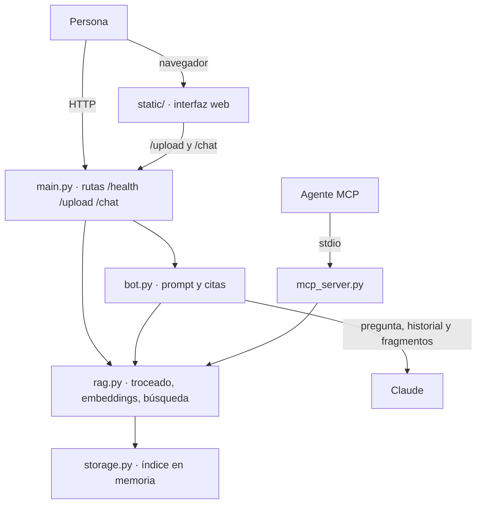

# Plan 007 — Publicación y portafolio

Estado: implementado


## Alcance y supuestos
- Se implementa solo la publicación: README, diagrama, `.env.example`, `.gitignore`, workflow de CI, `LICENSE`, `Dockerfile`, `.dockerignore`, GIF de demostración y los pasos de git y GitHub. No cambia el producto.
- No se modifican `app/`, `static/`, `tests/`, `models.py` ni `requirements.txt`. No se añaden dependencias de Python: todo se apoya en lo ya fijado y en herramientas externas que no se declaran en el proyecto (git, Docker, `ffmpeg` si hace falta para el GIF).
- No hay funciones nuevas de producto ni lógica que dependa de la fecha. Los únicos datos temporales son el año **2026** de `LICENSE`, las fechas de la autoevaluación y la fecha de publicación; se escriben como texto y no se calculan. Por eso no hay parámetro `hoy`.
- El repositorio no es git todavía, el README es mínimo, `.gitignore` tiene tres líneas, `.env.example` tiene una, y no existen `.github/`, `Dockerfile`, `.dockerignore`, `LICENSE` ni GIF. Sí existen `demo_sin_tokens.py`, `diagnostico.py`, `.vscode/`, `.opencode/` y `.agents/`.
- D1–D11 se mantienen. El usuario u organización de GitHub y la URL real siguen pendientes de publicación; no se inventan. El GIF y la prueba manual con clave real son no bloqueantes según D6.
- La publicación efectiva en GitHub requiere una cuenta y credenciales del usuario. Si no están disponibles, la parte local se completa y la publicación se registra como pendiente; la spec no se marca implementada hasta que C-14 se cumpla.
- Base de partida: el último registro de `MEMORY.md` es `pytest -q` → **1166 passed, 1 skipped** y `ruff check .` → **All checks passed!**. T0 lo confirma antes de tocar nada.
- Supuestos que se confirman en T0 (no se dan por ciertos):
  1. Hay Docker disponible para construir y ejecutar la imagen.
  2. Hay red para `docker build` y para instalar dependencias; el modelo se descarga en el build.
  3. `python:3.12-slim` está disponible como etiqueta oficial concreta y no es `latest`.
  4. `sentence-transformers==6.2.0` descarga el modelo en `HF_HOME` y lo carga después sin red con esa caché.
  5. `uvicorn` escucha en `0.0.0.0:8000` dentro del contenedor y `-p 8000:8000` lo hace accesible.
  6. `actions/checkout@v4` y `actions/setup-python@v5` funcionan con Python 3.12 y `ubuntu-24.04`; si el runner no existe en la cuenta, se usa `ubuntu-latest` y se documenta.
  7. La URL del badge de GitHub Actions responde y refleja la rama `main` y el workflow `ci.yml`.
  8. Hay una clave real disponible para el GIF o, si no la hay, se documenta el pendiente. Para el GIF hace falta además una herramienta de conversión a GIF (`ffmpeg` u otra local); si no existe, no se publica un archivo falso.

## Aprobaciones necesarias (según `AGENTS.md`)
Las decisiones D1–D11 cubren el alcance, pero `AGENTS.md` exige aprobar los archivos nuevos que no están en la estructura. T0 las registra por escrito.

1. **Archivos nuevos en la raíz:** `LICENSE`, `Dockerfile`, `.dockerignore` y `.github/workflows/ci.yml`. `docs/demo.gif` se crea solo si hay GIF. No se crea `docker-compose`, ni un registro de imágenes, ni un despliegue.
2. **Archivos existentes que se modifican:** `README.md`, `.env.example`, `.gitignore`, `MEMORY.md`, `docs/constitution.md`, `docs/roadmap.md` y el estado de `specs/007-publicacion-portafolio/{spec,plan,tasks}.md`.
3. **Sin cambios de producto:** ni `app/`, ni `static/`, ni `tests/`, ni `requirements.txt`, ni los esquemas de `models.py`, ni el formato de los chunks.
4. **Sin dependencias nuevas:** no se añade nada a `requirements.txt`; las comprobaciones de enlaces y de secretos usan la biblioteca estándar, `git`, `curl` o revisión manual.
5. **Constitución:** de `docs/constitution.md` solo se quita la «v» suelta del final de la línea 13. No se cambia ningún principio.
6. **Publicación:** crear el repositorio público y el remoto requiere la cuenta del usuario. No se inventa usuario, URL ni badge.
7. **Si un supuesto falla** (Docker, modelo offline, acciones o runner), se detiene la tarea y se pregunta antes de cambiar la imagen base, el modelo o añadir una dependencia.

## Estado de partida y contratos que se documentan
El README no puede prometer nada que no exista. Estos son los contratos reales de las specs 001–006 que se citan; cualquier otro detalle se remite a `/docs`.

### Rutas y respuestas
| Ruta | Entrada | Éxito | Errores que el README explica |
|---|---|---|---|
| `GET /health` | — | `200` `{"status": "ok"}` | `405` `method_not_allowed` |
| `POST /upload` | `multipart/form-data`: `file` obligatorio (`.py`), `path` opcional | `200` `UploadResponse`: `file_path`, `chunks_indexed`, `total_chunks`, `used_windows`, `message` | `400` `invalid_path`, `invalid_extension`, `invalid_encoding`; `411` `length_required`; `413` `payload_too_large`; `422` `invalid_request`; `500` `internal_error` |
| `POST /chat` | JSON: `message` obligatorio, `history` opcional (por defecto `[]`) | `200` `ChatResponse`: `reply`, `citations[]` (`number`, `file_path`, `symbol_name`, `start_line`, `end_line`), `reason` (`null` o motivo) | `411` `length_required`; `413` `payload_too_large`; `422` `invalid_request`; `500` `internal_error`; `502` `api_error`; `503` `missing_api_key`, `invalid_api_key`, `api_unavailable`; `504` `api_timeout` |
| `GET /` y `GET /static/*` | — | La interfaz web y sus recursos | No forman parte del contrato de la API; se sirven con `uvicorn app.main:app` |

- El formato de error es siempre `{message, reason}`. El README no inventa campos `detail` ni estados distintos.
- Los resultados sin respuesta del chat devuelven **200**: `empty_index`, `no_relevant`, `insufficient_context` y `ungrounded_answer`. No son fallos del producto.
- Sin clave, la aplicación arranca, `/health` responde, `/upload` y las herramientas MCP funcionan, y `/chat` devuelve `503` con `missing_api_key`.

### Mensajes exactos que se citan
| Caso | HTTP | `reason` | `message` literal |
|---|---|---|---|
| Chat sin clave | 503 | `missing_api_key` | `Falta la clave de acceso al modelo. Configúrala en la variable de entorno ANTHROPIC_API_KEY y vuelve a intentarlo.` |
| Chat con índice vacío | 200 | `empty_index` | `Todavía no hay código indexado. Sube un archivo .py para poder buscar en él.` |
| Chat sin fragmentos relevantes | 200 | `no_relevant` | `No encontré fragmentos relevantes para esa consulta. Prueba con otras palabras.` |
| Chat con contexto insuficiente | 200 | `insufficient_context` | `No encontré la respuesta en el código indexado. Prueba a reformular la pregunta o a indexar más archivos.` |
| Chat sin respaldo | 200 | `ungrounded_answer` | `No pude respaldar la respuesta con fragmentos concretos del código, así que prefiero no mostrarla. Prueba a reformular la pregunta.` |
| Extensión no `.py` | 400 | `invalid_extension` | `Solo se aceptan archivos de Python (.py).` |
| Ruta inválida | 400 | `invalid_path` | `La ruta del archivo no es válida: no puede estar vacía, superar 255 caracteres ni contener saltos de línea u otros caracteres de control.` |
| Codificación no UTF-8 | 400 | `invalid_encoding` | `No se pudo leer el archivo como texto UTF-8. Guárdalo con codificación UTF-8 y vuelve a subirlo.` |
| Subida demasiado grande | 413 | `payload_too_large` | `La petición es demasiado grande: el límite son 1.052.672 bytes (1 MiB de archivo más el margen del formulario de subida).` |
| Chat demasiado grande | 413 | `payload_too_large` | `El mensaje y el historial son demasiado grandes.` |
| Falta `Content-Length` | 411 | `length_required` | `La petición debe indicar su tamaño (cabecera Content-Length).` |
| Petición inválida | 422 | `invalid_request` | `La petición no es válida. Revisa los datos enviados.` |
| Error interno | 500 | `internal_error` | `Ocurrió un error interno. Inténtalo de nuevo; si sigue fallando, revisa los registros.` |
| Ruta inexistente | 404 | `not_found` | `No existe esa ruta.` |
| Método no permitido | 405 | `method_not_allowed` | `Ese método no está permitido en esta ruta.` |

Los mensajes de `rag.py` y `bot.py` se copian literalmente del código; no se reescriben para el README. El semáforo «sin clave» y el estado «sin índice» se explican antes de que el lector los encuentre.

### Límites reales
| Constante | Valor | Consecuencia documentada |
|---|---|---|
| `rag.MAX_FILE_BYTES` | `1_048_576` (1 MiB) | Un `.py` mayor se rechaza con `413` |
| `main.UPLOAD_BODY_LIMIT` | `1_052_672` | Límite del cuerpo multipart completo |
| `main.CHAT_BODY_LIMIT` | `262_144` | Límite del JSON de `/chat` |
| `rag.MAX_QUERY_LENGTH` | `1_000` | Pregunta o consulta máxima |
| `rag.MAX_RESULTS` | `5` | Fragmentos devueltos por búsqueda |
| `rag.MIN_SCORE` | `0.30` | Umbral de relevancia |
| `rag.MAX_CHUNKS_PER_FILE` | `1_000` | Tope de fragmentos por archivo |
| `rag.MAX_MODULE_BLOCK_LINES` | `120` | Trozo máximo del bloque de módulo |
| `rag.WINDOW_LINES` | `60` | Ventana del plan B |
| `main.MAX_PATH_CHARS` | `255` | Ruta efectiva máxima |
| `bot.MAX_HISTORY_MESSAGES` | `10` | Mensajes de historial enviados |
| `bot.MAX_HISTORY_MESSAGE_CHARS` | `4_000` | Caracteres por mensaje del historial |
| `bot.MAX_FRAGMENT_CHARS` | `6_000` | Caracteres por fragmento en el contexto |
| `bot.MAX_CONTEXT_CHARS` | `20_000` | Contexto total enviado al modelo |
| `bot.API_TIMEOUT_SECONDS` | `30.0` | Espera por intento del modelo |
| `bot.API_MAX_RETRIES` | `1` | Reintento del cliente oficial |

El README documenta los límites prácticos (`.py`, 1 MiB, 1.000 caracteres, 5 fragmentos, 10 mensajes, sin persistencia, solo chat con clave) y no abruma con constantes internas; las constantes exactas quedan aquí para que la revisión no invente cifras.

### Variables de entorno
| Variable | Obligatoria | Para qué | Dónde se documenta |
|---|---|---|---|
| `ANTHROPIC_API_KEY` | Solo para `/chat` | Clave del modelo; se lee del entorno y nunca del código | `.env.example`, README (configuración y Docker) |
| `CODEMENTOR_REAL_MODEL` | No | Activa la prueba opcional con el modelo real (`tests/test_rag.py:388-389`); por defecto está comentada | `.env.example` y README de pruebas |
| `HF_HOME` | No, uso interno de Docker | Ruta de la caché del modelo dentro de la imagen (`/opt/models`); no es una variable del usuario | `Dockerfile`, no se pide al lector |

No hay otras variables de la aplicación. `ANTHROPIC_API_KEY` vacía es una configuración válida que arranca y deja el chat en el error documentado.

### Herramientas MCP
| Herramienta | Argumentos | Resultado |
|---|---|---|
| `search_code` | `query` (texto obligatorio) | Hasta 5 bloques con ruta, símbolo, líneas, relevancia y texto |
| `index_file` | `path` y `content` (textos obligatorios) | Mensaje de éxito, ruta, fragmentos indexados, total y troceado por ventanas |

El ejemplo del README usa `python -m app.mcp_server` con el inspector oficial. El índice es propio de cada proceso: hay que indexar antes de buscar y en la misma sesión. No se lee el disco ni se ejecuta el contenido.

## Archivos y responsabilidades
| Archivo | Responsabilidad | Lo que NO hace |
|---|---|---|
| `README.md` | Puerta de entrada: qué es, estado real, diagrama, requisitos, inicio rápido, ejemplos, demo, Docker, decisiones, estructura, stack, límites, pruebas, seguridad y licencia | No promete funciones futuras, no muestra URL/badge inventados y no repite la clave |
| `docs/demo.gif` | Único GIF de 10–20 s con subida, pregunta y respuesta con citas | No es un mockup, no lleva audio, no muestra claves ni rutas locales, no se enlaza si no existe |
| `.github/workflows/ci.yml` | Ejecuta `ruff check .` y `pytest -q` en push y pull request, sin secretos ni modelo | No publica imágenes, no despliega, no ejecuta frontend ni `ruff format --check`, no oculta fallos |
| `.env.example` | Enumera las variables con comentarios en español y valores vacíos o comentados | No contiene una clave válida ni activa la prueba real por defecto |
| `.gitignore` | Excluye entornos, cachés, `.env`, auxiliares, `.vscode/`, `node_modules`, bases de datos y artefactos | No ignora `.env.example`, `docs/`, `specs/` ni el GIF |
| `pytest.ini` | Añade la raíz del proyecto a `sys.path` para que `pytest -q` importe `app` en local y en CI | No cambia la suite, el workflow ni la configuración de Ruff |
| `LICENSE` | Texto MIT estándar, año 2026 y titular María Camila | No usa marcadores de posición |
| `Dockerfile` | Imagen local Python 3.12 con dependencias, modelo descargado en el build, usuario no root y arranque en `0.0.0.0:8000` | No copia `.env`, no recibe la clave en build, no publica en un registro, no usa `docker-compose` |
| `.dockerignore` | Deja el contexto de build en `app/`, `static/` y `requirements.txt` | No excluye lo necesario para arrancar |
| `MEMORY.md` | Estado real del proyecto y decisiones, sin secretos ni datos personales | No afirma que la prueba manual bloquee specs ya implementadas (C-30) |
| `docs/constitution.md` | Corregir solo la «v» suelta de la línea 13 | No cambia principios ni reglas |
| `docs/roadmap.md` | Marcar la 007 como implementada cuando se cumpla C-14; si no, dejar el estado real | No adelanta el estado |
| `specs/007-publicacion-portafolio/{spec,plan,tasks}.md` | Pasar a implementada al cerrar; si la publicación queda pendiente, no marcarla implementada | No se declara cerrada sin la URL real |

## Contenido exacto del README
### Orden y secciones
El README lleva exactamente estas secciones visibles, en este orden; se pueden añadir notas cortas dentro de ellas, pero no se cambia el orden:

1. **Qué es CodeMentor y qué problema resuelve**: tres frases como máximo. Incluye una nota de estado: specs 001–006 implementadas; 007 en publicación; prueba manual con clave real y GIF como pendientes si no se han podido completar; índice sin persistencia.
2. **Funcionalidades principales**: subida e indexado, búsqueda con embeddings, chat con citas, interfaz web, API HTTP y herramientas MCP.
3. **Diagrama de arquitectura**: el Mermaid de abajo.
4. **Requisitos previos**: Python 3.12, pip, git, conexión para instalar y descargar el modelo; Docker opcional; clave de Anthropic solo para el chat.
5. **Inicio rápido**: comandos copiables, comprobación de `/health`, advertencia de primera ejecución y nota de PowerShell.
6. **Ejemplos de uso**: API con `curl`, interfaz web y MCP con el inspector; resultado esperado de cada uno.
7. **Demo**: GIF si existe; si no, una frase de pendiente sin enlace.
8. **Uso con Docker**: build, ejecución, tamaño medido, clave en runtime, comportamiento sin clave y límites.
9. **Decisiones y porqués**: al menos seis, cada una con decisión, motivo y alternativa descartada.
10. **Estructura del proyecto**: árbol real y una línea por carpeta/archivo; distingue producto, pruebas, documentación, configuración de trabajo, raíz publicada y artefactos.
11. **Stack**: Python 3.12, dependencias fijadas y su papel, modelo de embeddings con enlace oficial.
12. **Límites conocidos**: los de RF-9, con su consecuencia práctica.
13. **Pruebas y lint**: `pytest -q` y `ruff check .`, qué se mockea, que no hay red en las pruebas, que la instalación sí puede usar red, y los tiempos medidos de la autoevaluación.
14. **Seguridad**: las notas de RF-28, con la excepción del temporal efímero.
15. **Licencia MIT y CI**: enlace a `LICENSE`; badge solo con la URL real y la rama `main`. Antes de publicar, texto que declara que el workflow existe pero el badge está pendiente.

No se añade una sección separada de «Roadmap» que presente ideas como disponibles; si se mencionan ideas futuras, van dentro de «Límites conocidos» con la marca **Pendiente** y sin enlaces a código inexistente.

### Diagrama Mermaid
Se usa Mermaid en vez de una imagen: es texto, se revisa en el diff, se renderiza en GitHub y no se desincroniza. El bloque exacto es:



El diagrama muestra que `mcp_server.py` consume `rag.py` sin pasar por HTTP y que el índice es el mismo singleton del proceso. Si la arquitectura cambia, el diagrama se actualiza en el mismo cambio.

### Inicio rápido
Comandos exactos (8 comandos efectivos; las variantes de Windows/Linux no se cuentan dos veces):

```bash
git clone https://github.com/<usuario>/codementor.git
cd codementor
python -m venv venv
venv\Scripts\activate        # Windows
source venv/bin/activate     # Linux/macOS
pip install -r requirements.txt
copy .env.example .env       # Windows
cp .env.example .env         # Linux/macOS
uvicorn app.main:app
curl http://localhost:8000/health
```

- `<usuario>` se sustituye por el usuario real **solo al publicar**. Antes de esa fecha, el README usa la carpeta local y una nota de pendiente; no muestra una URL inventada.
- En PowerShell, `curl` es un alias de `Invoke-WebRequest`: el README indica usar `curl.exe` para los ejemplos.
- La respuesta esperada de `/health` es `{"status":"ok"}`. Si el modelo aún se está descargando, la primera ejecución puede tardar y `/health` no responde al instante; el README lo advierte y no promete instantaneidad.
- La primera instalación y la primera descarga del modelo se miden aparte y se documentan con su tiempo real. El camino de cinco minutos se mide con dependencias y modelo ya disponibles.
- Copiar `.env.example` a `.env` con la clave vacía es una configuración válida: arranca y el chat devuelve el `503` documentado.

### Ejemplos de uso
**API HTTP** (todos usan archivos que existen en el repositorio):

```bash
curl -s http://localhost:8000/health
curl -F "file=@app/rag.py" -F "path=app/rag.py" http://localhost:8000/upload
curl -F "file=@README.md" http://localhost:8000/upload
curl -X POST http://localhost:8000/chat \
  -H "Content-Type: application/json" \
  -d '{"message":"¿Dónde se calculan los embeddings?","history":[]}'
```

- `/health` → `{"status":"ok"}`.
- `/upload` con `app/rag.py` → `file_path` `app/rag.py`, contadores y `message`; sin `path`, la ruta efectiva es el nombre del archivo.
- `/upload` con `README.md` → `400` `invalid_extension` y el mensaje literal. Sirve para mostrar la regla sin ambigüedad.
- `/chat` sin clave → `503` `missing_api_key`; con clave → `reply` con marcas `[Fn]` y `citations` con archivo, símbolo y líneas. `history` es opcional; si se omite, la API usa `[]`. El ejemplo puede incluir `history: []` como convención, pero lo declara opcional.
- No se documentan `GET /upload`, cuerpos gigantes ni rutas que no existan.

**Interfaz web**: abrir `http://localhost:8000`, subir `app/rag.py`, escribir `¿Dónde se calculan los embeddings?` y comprobar que la respuesta trae citas visibles. Sin clave se ve el aviso de `empty_index` o el error de clave, no un fallo de la página.

**MCP**:

```bash
npx @modelcontextprotocol/inspector python -m app.mcp_server
```

En el inspector:
1. `index_file` con `path: "tests/test_health.py"` y el contenido de ese archivo (18 líneas, existe en el repositorio).
2. `search_code` con `query: "health"`.
3. Resultado esperado: un bloque con `Ruta: tests/test_health.py`, el símbolo `test_health_returns_ok` y sus líneas. El índice es de ese proceso; si se reinicia, vuelve a estar vacío.

No se promete que el índice MCP se comparta con el servidor HTTP ni que sobreviva al reinicio.

### Decisiones que el README debe contar
Como mínimo, estas seis, con motivo y alternativa descartada:

| Decisión | Motivo | Alternativa descartada |
|---|---|---|
| Capas `main.py → bot.py → rag.py → storage.py`, con `mcp_server.py` consumiendo `rag.py` | Cada capa se prueba y se cambia sin arrastrar las demás; MCP no depende de HTTP | Un módulo único o MCP pasando por la API |
| Troceado por función y clase con `ast`, bloque de módulo y plan B por ventanas | Las citas apuntan a símbolos y líneas reales; un archivo roto no se pierde | Trocear por párrafos o rechazar archivos no analizables |
| Embeddings normalizados y producto punto como similitud coseno, umbral 0,30 | Búsqueda rápida y determinista sin índice aproximado | Vectores sin normalizar o búsqueda por palabras clave |
| Citas construidas desde los resultados de la búsqueda, no desde el texto del modelo | Evita rutas, funciones y líneas inventadas; si no hay respaldo, falla cerrando | Confiar en las citas que escriba el modelo |
| Índice en memoria, singleton del proceso | Sencillo, privado y suficiente para esta versión; se pierde al reiniciar y es esperado | Persistencia en SQLite (008a) o en disco |
| Carga diferida del modelo con `lru_cache` | La aplicación arranca y las pruebas corren sin descargar el modelo; la primera petición paga la carga | Cargar el modelo al importar o en cada petición |

Se pueden añadir las decisiones de Docker (modelo en el build), CI (solo dos comandos), GIF único y licencia MIT, pero las seis anteriores son obligatorias.

### Estructura, stack y límites
- **Estructura:** árbol real con `app/`, `static/`, `tests/`, `docs/`, `specs/`, `.github/workflows/`, `.opencode/`, `.agents/`, `README.md`, `AGENTS.md`, `MEMORY.md`, `opencode.json`, `requirements.txt`, `.env.example`, `.gitignore`, `.dockerignore`, `Dockerfile`, `LICENSE` y `docs/demo.gif` si existe. Se distingue producto (`app/`, `static/`), pruebas (`tests/`), documentación (`docs/`, `specs/`), configuración de trabajo (`.opencode/`, `.agents/`, `AGENTS.md`, `MEMORY.md`, `opencode.json`), archivos raíz publicados y artefactos de publicación. No aparecen `demo_sin_tokens.py`, `diagnostico.py`, `.vscode/`, `venv/`, cachés ni `node_modules`.
- **Stack:** Python 3.12; `fastapi==0.161.0`, `starlette==1.9.0`, `uvicorn==0.54.0`, `pydantic==2.14.1`, `python-dotenv==1.2.4`, `sentence-transformers==6.2.0`, `numpy==2.5.4`, `anthropic==2.1.0`, `mcp==2.3.0`, `python-multipart==0.0.32`; pruebas `pytest==9.1.1`, `httpx==0.28.1`, `httpx2==2.16.0`, `ruff==0.17.2`. Modelo de embeddings: `paraphrase-multilingual-MiniLM-L12-v2`, con enlace a `https://huggingface.co/sentence-transformers/paraphrase-multilingual-MiniLM-L12-v2`. No se enumeran dependencias que no estén en `requirements.txt`.
- **Límites conocidos:** índice en memoria y pérdida al reiniciar; índice MCP propio de cada proceso; solo `.py`; el chat requiere clave y envía pregunta, historial y fragmentos a Claude; la clave no hace falta para arrancar; la primera ejecución local descarga el modelo y puede tardar; en Docker el modelo ya está en la imagen; no hay autenticación, TLS ni persistencia; no se indexa JavaScript; el archivo subido nunca se ejecuta. Cada límite lleva su consecuencia práctica.

### Seguridad, licencia y estado
Las notas de seguridad repiten exactamente RF-28:
- La clave vive solo en `ANTHROPIC_API_KEY`; nunca en el código, el README, `Dockerfile`, `.env.example` ni el historial.
- `.env` está ignorado; `.env.example` es el único archivo de ese tipo que se publica.
- El `Dockerfile` no hornea la clave; se pasa con `docker run -e`.
- El código subido nunca se ejecuta, importa ni evalúa.
- La aplicación no guarda el código en disco, salvo el archivo temporal efímero que Starlette puede crear para subidas grandes (1 MiB + 4 KiB) y que se borra al terminar la petición.
- A Claude solo se envían la pregunta, el historial y los fragmentos recuperados.
- El índice vive en memoria y se pierde al reiniciar.
- No hay autenticación ni TLS; no debe exponerse directamente a internet.
- El contenedor no monta el código del usuario, no persiste el índice y no escribe datos de la aplicación en el host.

La sección de licencia enlaza a `LICENSE` y declara MIT, sin repetir el nombre de la titular. El badge se añade solo cuando existe la URL real:

```markdown
[](https://github.com/<usuario>/codementor/actions/workflows/ci.yml)
```

Antes de publicar, en su lugar va una frase: «El workflow está en `.github/workflows/ci.yml`; el badge se añadirá cuando el repositorio esté publicado». No se muestra una URL ni un badge inventados.

## Contrato del workflow
Archivo: `.github/workflows/ci.yml`. Nombre del workflow: `CI`; trabajo: `checks`. Este es el contenido de referencia:

```yaml
name: CI

on:
  push:
  pull_request:

permissions:
  contents: read

jobs:
  checks:
    runs-on: ubuntu-24.04
    timeout-minutes: 15
    steps:
      - name: Descargar el repositorio
        uses: actions/checkout@v4
      - name: Preparar Python 3.12
        uses: actions/setup-python@v5
        with:
          python-version: "3.12"
      - name: Instalar dependencias fijadas
        run: python -m pip install -r requirements.txt
      - name: Revisar el estilo
        run: ruff check .
      - name: Ejecutar las pruebas
        run: pytest -q
```

- **Eventos:** push y pull request, sin filtro de ramas; cumple RF-15 y RF-16.
- **Permisos:** solo `contents: read`; no hay `pull_request_target`, no hay `secrets`, no hay `env` con credenciales y no se expone nada a bifurcaciones (RF-21, C-27).
- **Python:** `3.12` literal, la misma versión menor que el README (RF-22, RNF-11, C-29).
- **Dependencias:** solo `python -m pip install -r requirements.txt`; no se ejecuta `pip install --upgrade pip` ni se instala `pytest`, `ruff` u otro paquete aparte (RF-17, C-28). `setup-python` aporta Python y pip, no un paquete del proyecto.
- **Comandos:** exactamente `ruff check .` y `pytest -q`; no `ruff format --check`, no frontend, no `-k`, no `--ignore`, no `|| true`, no `continue-on-error` (RF-19, RF-20, RF-23, C-7).
- **Sin caché:** no se usa `cache: pip` ni artefactos; el resultado no depende de la caché del runner (RNF-4, C-26).
- **Sin reintentos:** no hay pasos de reintento ni acciones que los hagan; dos ejecuciones del mismo commit producen el mismo resultado salvo causas externas documentadas (RNF-4, C-26).
- **Tiempo:** `timeout-minutes: 15`; si se acerca al límite, se investiga antes de cerrar (RNF-3, C-8).
- **Prueba opcional:** `CODEMENTOR_REAL_MODEL` no se define; la prueba de `tests/test_rag.py:388-389` aparece omitida por su propio `skipif`. Esa omisión declarada no cuenta como exclusión de la suite (C-7, C-8).
- **Runner:** `ubuntu-24.04` es una etiqueta fija; si la cuenta no la ofrece, se usa `ubuntu-latest` y se documenta que la prohibición de `latest` de RNF-5 se refiere a la imagen base y a las acciones, no al runner. T6 validó el YAML y el contrato, pero la disponibilidad real de la etiqueta en la cuenta solo se confirma con la primera ejecución de T10.
- **Acciones:** `actions/checkout@v4` y `actions/setup-python@v5` son etiquetas mayores fijadas, no `@latest` ni `@main`. Si se exige una reproducibilidad byte a byte, se fijan a un SHA verificado en T6 y se documenta; no se inventa el SHA.

## Contrato de Docker
### `Dockerfile`
Contenido de referencia; el modelo se descarga en el build y queda en `/opt/models`:

```dockerfile
# syntax=docker/dockerfile:1
FROM python:3.12-slim

ENV PYTHONDONTWRITEBYTECODE=1 \
    PYTHONUNBUFFERED=1 \
    PIP_NO_CACHE_DIR=1 \
    HF_HOME=/opt/models

WORKDIR /app

COPY requirements.txt .
RUN python -m pip install --no-cache-dir -r requirements.txt

COPY app ./app
COPY static ./static

RUN python -c "from sentence_transformers import SentenceTransformer; SentenceTransformer('paraphrase-multilingual-MiniLM-L12-v2')"

RUN useradd --create-home --uid 10001 appuser \
    && chown -R appuser:appuser /app /opt/models

USER appuser

EXPOSE 8000

CMD ["uvicorn", "app.main:app", "--host", "0.0.0.0", "--port", "8000"]
```

- No hay `ARG ANTHROPIC_API_KEY`, `ENV ANTHROPIC_API_KEY`, `COPY .env` ni `COPY .`; el contexto se limita con `.dockerignore`.
- La descarga del modelo ocurre como `root` antes de cambiar de usuario y se guarda en `HF_HOME`; después se ajusta el propietario. T5 confirma que `appuser` puede leerla.
- `EXPOSE 8000` es documentación; el arranque real escucha en `0.0.0.0:8000`. El README usa `-p 8000:8000`.
- No se añade `HEALTHCHECK`: el calentamiento y el modelo ya están en la imagen, y un healthcheck con un `start-period` mal medido daría falsos negativos. Se verifica a mano con `curl`.
- No se usa `docker-compose`, no se publica en un registro y no se incluye `docker push`.

### `.dockerignore`
Lista fija, sin condicionales; conserva solo `app/`, `static/` y `requirements.txt`:

```text
.env
.env.*
venv/
.venv/
env/
__pycache__/
*.py[cod]
.pytest_cache/
.ruff_cache/
.git/
.gitignore
.github/
.vscode/
.idea/
.opencode/
.agents/
node_modules/
docs/
specs/
tests/
pytest.ini
demo_sin_tokens.py
diagnostico.py
*.db
*.sqlite
*.sqlite3
*.log
logs/
*.gif
*.mp4
README.md
AGENTS.md
MEMORY.md
opencode.json
LICENSE
Dockerfile
.dockerignore
```

`requirements.txt`, `app/` y `static/` no se excluyen. Si el build falla porque falta uno de ellos, se corrige el `.dockerignore`, nunca se añade un `COPY .` global.

### Comandos de build y ejecución
```bash
docker build -t codementor:local .
docker image inspect --format "{{.Size}}" codementor:local
docker run --rm -p 8000:8000 -e ANTHROPIC_API_KEY=... codementor:local
```

- El marcador `...` nunca se sustituye por una clave real en el README.
- El build necesita internet para dependencias y modelo; `docker run` no descarga el modelo y el chat necesita red hacia Anthropic.
- Prueba sin clave: `docker run --rm -p 8000:8000 --name codementor-demo codementor:local`; `/health` responde tras el calentamiento, `/upload` funciona y `/chat` devuelve el `503` documentado.
- Prueba de que no descarga en runtime: `docker run --rm --network none -p 8000:8000 codementor:local`; `/health` y una subida deben funcionar. Si falla por el modelo, se corrige la ruta de caché, no se elimina la prueba.
- Inspección de contenido: `docker run --rm --entrypoint sh codementor:local -c 'test ! -e /app/docs && test ! -e /app/specs && test ! -e /app/tests && test ! -e /app/.env && test ! -e /app/.git'`.
- Tamaño: se mide en bytes con `docker image inspect` y se convierte a MiB; se documenta el valor real en el README. No se promete un tamaño concreto.
- Segunda construcción del mismo commit: debe arrancar y responder; no se exige que sea idéntica byte a byte (RNF-13, C-20).

## Contrato del GIF
- Ruta: `docs/demo.gif`, referenciada desde el README como `docs/demo.gif` (ruta relativa). Se elige `docs/` porque ya existe y se publica; `assets/` sería una carpeta nueva fuera de la estructura y no aporta nada.
- Texto alternativo: `Demostración de CodeMentor: se sube un archivo .py, se pregunta «¿Dónde se calculan los embeddings?» y la respuesta muestra citas con archivo, símbolo y líneas.`
- Duración: 10–20 s. Peso: ≤5 MB. Sin audio. Sin capturas estáticas adicionales.
- Contenido: subida de `app/rag.py` con ruta `app/rag.py`, mensaje de éxito, pregunta, espera y respuesta con citas visibles. No se muestra la clave, ni `.env`, ni rutas absolutas, ni código ajeno.
- Grabación: ventana limpia de 1280×800, zoom 100%, sin marcadores ni pestañas personales; servidor arrancado con clave y modelo en caché; recargar para limpiar la conversación; grabar con el MCP `chrome-devtools` (`screencast_start`/`screencast_stop`) o con una grabadora local; recortar a 10–20 s.
- Conversión a GIF con `ffmpeg`, si está disponible:
  ```bash
  ffmpeg -i demo.mp4 -vf "fps=12,scale=960:-1:flags=lanczos,split[s0][s1];[s0]palettegen=max_colors=128[p];[s1][p]paletteuse=dither=bayer" -loop 0 docs/demo.gif
  ```
- Revisión: `ffprobe` para la duración, tamaño del archivo, reproducción completa, y revisión fotograma a fotograma de claves, tokens, nombres de usuario y rutas locales. Si aparece algo sensible, se recorta, se sustituye o se vuelve a grabar.
- Si no hay clave o herramienta de conversión: no se crea un GIF falso, no se enlaza un archivo inexistente y el README declara el pendiente. T7 lo registra; no bloquea el cierre según D6. (T7, 2026-11-10: pendiente registrado; `ffmpeg` 8.1 sí está disponible, pero no había una clave real en el entorno y `.env` no se leyó por seguridad. No se creó `docs/demo.gif` ni ninguna captura estática.)

## Verificación de secretos, ignores y enlaces
### Revisión de secretos
Después de `git add -A`, antes del primer commit:

```bash
git grep --cached -nEI "sk-ant-[A-Za-z0-9_-]{10,}|ghp_[A-Za-z0-9]{20,}|github_pat_[A-Za-z0-9_]{20,}|AKIA[0-9A-Z]{16}|-----BEGIN (RSA|OPENSSH|EC|DSA) PRIVATE KEY-----"
git grep --cached -nE "ANTHROPIC_API_KEY=.+"
git grep --cached -nE "[A-Za-z]:\\\\Users\\\\|/home/[A-Za-z0-9._-]+/|/Users/[A-Za-z0-9._-]+/"
```

- Cualquier coincidencia se revisa a mano. Los marcadores `...`, las variables vacías y los ejemplos de documentación son aceptables; una cadena con pinta de credencial se retira, se rota y se vuelve a revisar el historial.
- También se revisan `opencode.json`, `AGENTS.md`, `MEMORY.md`, `docs/`, `specs/`, `.opencode/` y `.agents/` con la misma búsqueda, como exige RF-37.
- Si `.env` aparece en `git status` o en `git ls-files`, se para: no se hace commit, se corrige `.gitignore` y no se reescribe el historial. Si ya estuviera en el historial, se rota la clave y se pregunta antes de cualquier reescritura.
- Se comprueba `git ls-files` contra la lista permitida: no deben aparecer `demo_sin_tokens.py`, `diagnostico.py`, `.vscode/`, `venv/`, `__pycache__/`, `.pytest_cache/`, `.ruff_cache/`, `.env`, `node_modules/`, bases de datos ni logs.
- `.opencode/.gitignore` ya ignora `node_modules`, `package.json`, `package-lock.json` y `.gitignore`; no se usa `git add -f` sobre `.opencode/`. Se publican los agentes y las skills, no las dependencias locales.

### Verificación de `.gitignore`
Con el repositorio inicializado (sin commit), se crean y se comprueban estos casos; después se borran:

```bash
git check-ignore -v venv/ .venv/ __pycache__/ .pytest_cache/ .ruff_cache/ .env .env.local .vscode/ demo_sin_tokens.py diagnostico.py node_modules/ local.db app.log
```

- También se comprueba que **no** se ignoran `.env.example`, `README.md`, `docs/demo.gif`, `specs/`, `docs/`, `.opencode/agents/` ni `.agents/skills/`.
- `git status --short` después de ejecutar la aplicación y las pruebas no debe mostrar `.env`, `venv/`, `__pycache__`, `.pytest_cache`, `.ruff_cache`, `.vscode/`, `demo_sin_tokens.py` ni `diagnostico.py`.
- Si una regla no cubre una categoría de RF-26, se corrige antes de T9.

### Verificación de enlaces y rutas
- Todos los enlaces relativos del README se resuelven contra la raíz del repositorio con un script temporal de la biblioteca estándar (`re`, `pathlib`, `urllib.parse`); no se añade ninguna dependencia. Se comprueba que `app/rag.py`, `README.md`, `docs/demo.gif`, `LICENSE`, `.github/workflows/ci.yml` y las imágenes existan cuando se citan.
- Los enlaces externos (ficha del modelo, URL del repositorio y badge) se comprueban con `curl -I` cuando hay red; el badge debe devolver `200` y un SVG con el estado real.
- No se aceptan rutas `C:\...`, `/home/...`, `/Users/...` ni `file://` en el README, el GIF ni la documentación publicada.
- El README no enlaza `demo_sin_tokens.py`, `diagnostico.py` ni `.vscode/`.

### Verificación de tamaño
- GIF: ≤5 MB.
- Repositorio sin `venv/` ni artefactos: ≤25 MB. Se mide con `git count-objects -vH` y, en Windows, con una suma de archivos que excluya `.git` y `venv`; el resultado se anota en T11.
- Imagen: se mide con `docker image inspect` y se documenta en el README; no cuenta para el límite del repositorio.

## Secuencia de publicación
```text
1. Confirmar T0 y la base en verde.
2. Escribir artefactos de T1–T8 y verificar Docker, CI y GIF.
3. git init -b main (si no se hizo en T1).
4. git add -A.
5. git status --short; git diff --cached --stat; git ls-files.
6. Revisión de secretos, archivos prohibidos y tamaño.
7. git commit -m "chore: prepare public portfolio release".
8. Crear el repositorio público codementor en la cuenta personal, sin README, licencia ni .gitignore automáticos.
9. git remote add origin <URL real>.
10. git push -u origin main.
11. Esperar a que el workflow CI termine en verde.
12. Añadir al README la URL real de clon y el badge con la rama main.
13. git add README.md; git commit -m "docs: add repository URL and CI badge"; git push.
14. Esperar la nueva ejecución, comprobar el badge en verde y revisar el repositorio público.
```

- Si el usuario o las credenciales de GitHub no están disponibles, se detiene en el paso 7: el repositorio local queda listo, la URL y el badge no se inventan y T10 queda pendiente. La spec no se marca implementada hasta cumplir C-14.
- Si el workflow falla, no se añade el badge en verde: se corrige el fallo y se vuelve a ejecutar. No se usa `continue-on-error` ni se oculta el resultado.
- El badge se verifica con `curl -I` (200, `image/svg+xml`) y con el contenido SVG; si muestra `failing` o una ejecución antigua, se corrige antes de cerrar.

## Decisiones y alternativas descartadas
| Decisión | Por qué | Alternativa descartada |
|---|---|---|
| Mermaid en el README | Es texto, se revisa en el diff, se renderiza en GitHub y no se desincroniza | Imagen binaria: pesa, se queda obsoleta y no se revisa |
| GIF único en `docs/demo.gif` | `docs/` ya existe y se publica; una sola imagen muestra el flujo real | `assets/` nuevo o varias capturas estáticas: más mantenimiento y menos interacción |
| Docker de una sola etapa | El modelo se necesita en runtime; una etapa adicional no reduce la imagen final y complica la caché | Multi-stage: no aporta con este modelo |
| Modelo descargado en el build | `docker run` no depende de la red ni de la caché del host | Descargar en el arranque: primer `docker run` lento y dependiente de red |
| Usuario no root en el contenedor | Menor privilegio y coherencia con el principio 5; el modelo se hace legible con `chown` | `root`: más simple, pero innecesario |
| Workflow `ci.yml` con dos comandos | Es lo que fija la constitución y lo que el README documenta; rápido y sin herramientas nuevas | `tests.yml` con formato y frontend: alcance y dependencias nuevos |
| `ubuntu-24.04` y acciones con etiqueta mayor | Etiquetas fijas y legibles; no se usa `latest` ni `main` | `ubuntu-latest` y `@latest`: menos reproducibles |
| `git init` + primer commit único tras las comprobaciones | Evita commits intermedios con secretos y deja un primer commit limpio | Commit del código primero y documentación después: más riesgo y ruido |
| URL y badge solo con el valor real | Evita enlaces falsos y un badge que no corresponde a ninguna ejecución | Placeholder `github.com/usuario/codementor`: rompe el README y el badge |
| Badge después de la primera ejecución verde | Refleja un estado real y no un workflow que aún no ha corrido | Badge desde el primer commit: puede mostrar error o no existir |
| Licencia MIT con año y titular reales | Se puede reutilizar y no queda un marcador de posición | Sin licencia o con `[AÑO]`/`[NOMBRE]`: incumple RF-34 |
| Publicar la documentación de trabajo tras revisión | Muestra el proceso SDD, que es parte del portafolio | Publicar solo el código: oculta el diseño; publicar sin revisar: riesgo de datos |
| Autoevaluación guiada | No hay persona externa y deja evidencia de tiempos y tropiezos | Prueba con una persona ajena: bloquearía la verificación |
| Sin dependencias nuevas para verificar | La constitución exige que `pytest -q` pase solo con `requirements.txt`; `git`, `curl` y la biblioteca estándar bastan | Añadir un comprobador de enlaces o de YAML: dependencia nueva |
| `.dockerignore` fijo, sin condicionales | El contexto de build es predecible y no depende de lo que exista en la máquina | Reglas condicionales: resultado distinto según el entorno |
| Sin `HEALTHCHECK` en la imagen | Evita falsos negativos por el calentamiento; la verificación manual ya cubre `/health` | `HEALTHCHECK` con tiempos arbitrarios: puede marcar sano/falso sin necesidad |
| `python:3.12-slim` con etiqueta concreta | Cumple RNF-5 y RNF-13 sin fijar un digest que haya que mantener | `python:latest`: prohibido; digest no verificado: no se inventa |
| `MEMORY.md` corregido antes de publicar | El estado debe coincidir con `docs/roadmap.md` y no afirmar que 004/005 siguen abiertas | Dejar la frase: contradice la realidad publicada |

## Estrategia de verificación
### Qué se automatiza
No se añaden pruebas nuevas ni se modifica `tests/`: la spec es de publicación y el producto no cambia. Se ejecutan las comprobaciones existentes y comandos de publicación:

| Comprobación | Comando | Cuándo |
|---|---|---|
| Lint | `ruff check .` | T0, T1–T11 |
| Pruebas | `pytest -q` | T0, T1–T11 |
| Ignorados | `git check-ignore -v ...` | T1, T9 |
| Archivos rastreados | `git ls-files` | T9, T11 |
| Secretos | `git grep --cached -nE ...` | T9 |
| Enlaces relativos | script temporal con `re`/`pathlib` | T3, T11 |
| Workflow | revisión textual + `npx --yes yaml-lint .github/workflows/ci.yml` si hay Node; si no, validación en GitHub | T6, T10 |
| Docker | `docker build`, `docker run`, `docker image inspect` | T5, T11 |
| GIF | `ffprobe`, tamaño y revisión visual | T7, T11 |
| Badge | `curl -I` y SVG | T10 |
| Tamaño | `git count-objects -vH` / suma de archivos | T9, T11 |

`pytest -q` sigue siendo la única suite; no se usa `pytest --test` ni se reduce a un subconjunto. Las pruebas siguen mockeando Anthropic y embeddings y no descargan el modelo.

### Qué se revisa a mano
- **Autoevaluación guiada (RNF-1, RNF-2):** clon limpio, cronómetro y checklist; se anota cada tropiezo y se corrige. La segunda ejecución, con dependencias y modelo disponibles, mide el camino de cinco minutos. La primera instalación y la primera descarga se miden aparte.
- **README:** cada sección de RF-1, cada comando y cada ruta; render en GitHub; encabezados sin saltos; enlaces con texto descriptivo; bloques con lenguaje; sin rutas absolutas.
- **GIF:** duración, peso, contenido, texto alternativo y ausencia de datos sensibles; revisión fotograma a fotograma.
- **Docker:** build con red, ejecución sin clave, `/health`, subida, chat con error, frontend, `--network none`, inspección de contenido y tamaño.
- **GitHub:** workflow en push y PR, permisos, ausencia de secretos, ejecución verde, badge real, rama `main` y archivos publicados. Si hay una segunda cuenta, PR desde una bifurcación para C-27; si no, se revisa la configuración y se anota la limitación.
- **Estado real:** specs 001–006 implementadas, 007 en publicación o implementada, prueba manual y GIF pendientes si no se pudieron completar; nada se presenta como «en producción».

### Checklist de autoevaluación
1. Clonar en una carpeta temporal limpia; confirmar que no hay `.env`, `venv/`, cachés ni artefactos.
2. Crear el entorno virtual y activarlo en la plataforma que se use.
3. Ejecutar `pip install -r requirements.txt` y anotar el tiempo real.
4. Copiar `.env.example` a `.env`; dejarlo sin clave.
5. Arrancar `uvicorn app.main:app` y anotar cuánto tarda la primera carga/descarga.
6. `curl http://localhost:8000/health` → `{"status":"ok"}`.
7. Abrir `http://localhost:8000`, subir `app/rag.py` y comprobar el mensaje de éxito.
8. Preguntar sin clave y comprobar el `503` documentado.
9. Añadir una clave real en `.env` (solo en local), preguntar y comprobar `[Fn]` y las citas; si no hay clave, anotar el pendiente.
10. Medir el camino de cinco minutos con dependencias y modelo ya disponibles.
11. Repetir con Docker: build, ejecución sin clave, `/health`, subida y chat con error.
12. Anotar tropiezos, tiempos y correcciones; actualizar el README con los tiempos reales.

## Trazabilidad de requisitos
### Requisitos funcionales
| Requisito | Dónde se resuelve | Tarea |
|---|---|---|
| RF-1, RF-2, RF-3, RF-4, RF-5, RF-10, RF-29, RF-30, RF-35 | README: secciones, diagrama, inicio rápido, ejemplos, estado y comportamiento sin clave | T2, T3, T11 |
| RF-6, RF-7, RF-8, RF-9 | README: decisiones, estructura, stack y límites | T3 |
| RF-11, RF-12, RF-13, RF-14 | `docs/demo.gif`, sección Demo y texto alternativo; pendiente si no hay clave | T7 |
| RF-15, RF-16, RF-17, RF-18, RF-19, RF-20, RF-21, RF-22, RF-23 | `.github/workflows/ci.yml` y ejecución real en GitHub | T6, T10 |
| RF-24, RF-25, RF-26, RF-27 | `.env.example`, `.gitignore` y revisión de secretos | T1, T9 |
| RF-28, RF-31 | README: notas de seguridad y configuración de la clave | T3 |
| RF-32 | Repositorio local, `.gitignore` y primer commit | T9 |
| RF-33, RF-36, RF-37 | Publicación, exclusiones y revisión de documentos de trabajo | T8, T9, T10 |
| RF-34 | `LICENSE`, sección de licencia y badge real | T8, T10 |
| RF-38, RF-40, RF-41 | `Dockerfile`, `.dockerignore` y README de Docker | T4, T5 |
| RF-39, RF-42 | Contenedor sin clave, sin persistencia y sin ejecutar el código subido | T5 |

### Requisitos no funcionales
| Requisito | Dónde se resuelve | Tarea |
|---|---|---|
| RNF-1, RNF-2 | Autoevaluación guiada y tiempos medidos | T11 |
| RNF-3, RNF-4 | Workflow con timeout, sin caché ni reintentos; dos ejecuciones del mismo commit | T6, T10 |
| RNF-5 | Docker y workflow sin `latest` en base/acciones; herramientas de desarrollo excluidas | T4, T6 |
| RNF-6 | Documentación en español, salvo identificadores y comandos | T2, T3, T8 |
| RNF-7 | Render del README, enlaces relativos, GIF y jerarquía | T2, T3, T11 |
| RNF-8 | GIF ≤5 MB y repositorio ≤25 MB | T7, T9 |
| RNF-9 | Revisión de secretos, notas de seguridad y `.env` fuera de repo/imagen | T1, T3, T8, T9 |
| RNF-10, RNF-11 | README y workflow con la misma versión y comandos; distinción de red | T3, T6 |
| RNF-12 | Texto alternativo, encabezados y enlaces descriptivos | T3, T7 |
| RNF-13 | Insumos fijados, build limpio y segunda construcción funcionalmente equivalente | T4, T5 |
| RNF-14 | Badge real de la rama `main` y del workflow actual | T10 |

### Criterios de finalización
| Criterio | Tarea |
|---|---|
| C-1 | T9 |
| C-2, C-3 | T11 |
| C-4, C-5 | T2, T3, T11 |
| C-6 | T7 |
| C-7, C-8 | T6, T10 |
| C-9, C-10 | T1, T9 |
| C-11 | T3 |
| C-12 | T2, T5 |
| C-13 | T1, T3 |
| C-14 | T10 |
| C-15 | T8, T10 |
| C-16 | T2, T3, T11 |
| C-17 | T8, T9 |
| C-18 | T4, T5 |
| C-19 | T5 |
| C-20 | T4, T5, T6 |
| C-21 | T2, T3, T8 |
| C-22 | T7, T9 |
| C-23 | T3, T7 |
| C-24 | T11 |
| C-25 | T0 |
| C-26 | T6, T10 |
| C-27 | T6, T10 |
| C-28 | T6 |
| C-29 | T2, T6 |
| C-30 | T8 |

## Riesgos
- **Build de Docker largo o sin red:** descargar dependencias y el modelo puede tardar y necesita internet. Si no hay red, T5 no se puede cerrar; se documenta el bloqueo y no se simula una imagen. No se cambia la imagen base ni el modelo sin preguntar.
- **Modelo no disponible en runtime:** si `HF_HOME` no coincide entre build y runtime, el contenedor intentará descargar y fallará con `--network none`. Se corrige la ruta y se repite; no se elimina la prueba offline.
- **Usuario no root sin permisos:** si `appuser` no puede leer `/opt/models`, el arranque falla. Se ajusta `chown` o el orden de creación; no se vuelve a `root` sin justificarlo.
- **Workflow cerca de 15 minutos:** instalar `sentence-transformers` y sus dependencias puede ser lento. Se mide en T10; si se acerca al límite, se investiga sin añadir paquetes ni caché que oculten el problema. Si `ubuntu-24.04` no está disponible, se usa `ubuntu-latest` y se documenta.
- **Acciones con etiqueta mayor:** `@v4`/`@v5` pueden moverse dentro de su versión mayor. Si se exige más reproducibilidad, se fijan a un SHA verificado; no se inventa el SHA ni se usa `@latest`.
- **Publicación sin credenciales:** el usuario de GitHub puede no estar disponible. Se para antes del remoto, se documenta el pendiente y no se marca la spec como implementada; no se inventan URL ni badge.
- **Badge engañoso:** un badge cacheado o de una ejecución antigua puede mostrar verde con el workflow roto. Se comprueba el SVG y la última ejecución; si no coincide, se corrige la URL o se espera.
- **GIF demasiado grande o con datos:** se recorta, se comprime o se vuelve a grabar. Si no se puede, se documenta el pendiente; nunca se publica una imagen falsa ni se enlaza un archivo inexistente.
- **Secretos en documentación de trabajo:** `specs/`, `docs/`, `.opencode/` y `.agents/` son texto y pueden contener ejemplos. La revisión es manual además de por patrones; una credencial real se retira y se rota.
- **Primer commit con todo el proyecto:** al no haber historial, el primer commit incluye todo. Se revisa el índice (`git diff --cached`) antes de confirmar; si algo falla, se corrige antes del commit, no se reescribe el historial.
- **PowerShell y comandos del README:** `curl` es un alias y `copy`/`cp` difieren. El README indica `curl.exe` y las dos variantes; T11 prueba en Windows y, si es posible, en Linux/macOS.
- **`MEMORY.md` demasiado largo:** al añadir la 007 puede superar las ~50 líneas. Se resume lo antiguo y se conserva el estado y las decisiones vigentes; no se guardan datos personales.
- **Constitución:** la corrección de la «v» es solo tipográfica. Si se detecta otra contradicción, se pregunta antes de editar principios.

## Criterios para pasar a implementación
- `spec.md` en **aprobada**; `plan.md` y `tasks.md` aprobados por el usuario tras T0.
- Aprobaciones 1 a 7 resueltas por escrito y `AGENTS.md` sin contradicciones.
- Base en verde confirmada: `ruff check .` y `pytest -q` con las versiones fijadas.
- Supuestos 1 a 8 confirmados o el plan corregido antes de T1.
- Ninguna decisión pendiente salvo el usuario/URL de GitHub (publicación) y el GIF/clave real (no bloqueantes según D6).
- Confirmado que no se toca `app/`, `static/`, `tests/`, `requirements.txt` ni los esquemas.

## Resoluciones de T0

T0 cerrada el **2026-11-09**. El usuario aprobó la spec 007, este plan y `tasks.md`; `spec.md` ya figuraba en **aprobada** y este plan y `tasks.md` pasan a **aprobado**.

### Aprobaciones 1 a 7

1. **Archivos nuevos en la raíz:** aprobados `LICENSE`, `Dockerfile`, `.dockerignore` y `.github/workflows/ci.yml`; `docs/demo.gif` solo si se puede grabar un GIF real. No se crea `docker-compose`, ni un registro de imágenes, ni un despliegue.
2. **Archivos existentes que se modifican:** aprobados `README.md`, `.env.example`, `.gitignore`, `MEMORY.md`, `docs/constitution.md`, `docs/roadmap.md` y el estado de `specs/007-publicacion-portafolio/{spec,plan,tasks}.md`.
3. **Sin cambios de producto:** confirmado que no se tocarán `app/`, `static/`, `tests/`, `requirements.txt` ni los esquemas de `models.py`, ni el formato de los chunks.
4. **Sin dependencias nuevas:** confirmado que no se añade nada a `requirements.txt`; las comprobaciones usan la biblioteca estándar, `git`, `curl`, Docker o revisión manual.
5. **Constitución:** aprobada la corrección exclusivamente tipográfica de la «v» suelta al final de `docs/constitution.md:13`; no se cambia ningún principio.
6. **Publicación:** aprobada la publicación con la cuenta del usuario en el repositorio público `codementor`, rama `main`; el usuario y la URL real siguen pendientes de publicación y no se inventan.
7. **Supuesto que falla:** aprobado detener la tarea y preguntar antes de cambiar la imagen base, el modelo o añadir una dependencia.

### Base en verde

Ejecutado con el entorno del proyecto (`venv`, Python 3.12.10, ruff 0.17.2, pytest 9.1.1):

- `ruff check .` → **All checks passed!**
- `pytest -q` → **1166 passed, 1 skipped in 23.61s**

No se modificó ninguna prueba para obtener el verde.

### Supuestos 1 a 8

1. **Docker disponible:** confirmado. `docker --version` → Docker version 29.9.2, build a82e528.
2. **Red para el build:** confirmado que Docker alcanza el registro (`docker manifest inspect python:3.12-slim` respondió) y que hay red hacia Hugging Face (`HEAD` a la ficha del modelo → 200) y hacia GitHub (`git ls-remote` de las acciones). El build real se hará en T5.
3. **Etiqueta `python:3.12-slim`:** confirmada en el registro; el manifiesto incluye `linux/amd64` (digest `sha256:05a994d2344eb364cc186910f4fc8786a38215f39f00d0acc25bff33a08f4177`). No se descargó la imagen completa.
4. **Modelo en `HF_HOME` y carga sin red:** no se descargó el modelo en T0. Se verificará en T5: el build lo descargará en `/opt/models` y la ejecución con `--network none` comprobará que se carga desde esa caché. La ficha del modelo respondió 200.
5. **`uvicorn` en `0.0.0.0:8000`:** confirmado por diseño; `app/main.py` no arranca el servidor y el plan fija `uvicorn app.main:app --host 0.0.0.0 --port 8000` en el `CMD` del `Dockerfile`. La comprobación con `-p 8000:8000` corresponde a T5.
6. **Acciones y runner:** confirmadas las etiquetas `actions/checkout@v4` (`refs/tags/v4`) y `actions/setup-python@v5` (`refs/tags/v5`) con acceso al repositorio. `ubuntu-24.04` no se puede comprobar sin ejecutar el workflow; queda pendiente de T6/T10, con `ubuntu-latest` y su documentación como plan B si la cuenta no lo ofrece.
7. **URL del badge:** pendiente de publicación; no se inventa. Se añadirá y verificará en T10 con la URL real.
8. **Clave real y `ffmpeg` para el GIF:** `ffmpeg` disponible (versión 8.1). No hay `ANTHROPIC_API_KEY` en el entorno de esta sesión y no se leyó `.env` para no exponer secretos; la clave real y, por tanto, el GIF quedan como pendiente no bloqueante de T7, según D6.

### Cierre

- No se creó ningún artefacto de T1–T11 ni se ejecutó `docker build`, `git init` ni ningún commit.
- `spec.md` está en **aprobada**; `plan.md` y `tasks.md` quedan en **aprobado** y T0 marcada como hecha.
- `AGENTS.md` y la constitución no contradicen este plan.

## Incidencia de T10 — `pytest -q` y la raíz del proyecto

La primera ejecución real del workflow (`42937794855`, push de `d77565d`) falló en el paso `pytest -q` con `ModuleNotFoundError: No module named 'app'`. La causa no era el runner: el ejecutable `pytest` no añade el directorio actual a `sys.path`, mientras que `python -m pytest` sí; `tests/conftest.py` importa `app` y el comando del contrato es literalmente `pytest -q` (RF-23, C-29).

Se corrigió con un `pytest.ini` en la raíz que declara `pythonpath = .`, aprobado expresamente por el usuario el 2026-11-10. Se eligió configuración de pytest en vez de `python -m pytest -q` (habría exigido enmienda a RF-23/C-29), de `PYTHONPATH` en el workflow (no arreglaría el comando local del README) o de un `conftest.py` raíz (mismo efecto con código en vez de configuración). `pytest -q` pasa en local y en CI con este archivo; no se modificó `tests/` ni el workflow.

- Commit de la corrección: `6867329` (`fix: make pytest resolve the project root`); ejecución `42938428625` verde.
- Commit del badge: `e611fcb` (`docs: add repository URL and CI badge`); ejecución `42938750426` verde.
- El workflow emite un aviso no bloqueante de GitHub sobre Node.js 20 en `actions/checkout@v4` y `actions/setup-python@v5`; no afecta al resultado y no se cambian las etiquetas fijadas del plan.

## Verificación de T11 (2026-11-10)

T11 cerrada con la matriz de trazabilidad recorrida fila a fila y la autoevaluación guiada.

| Comprobación | Resultado |
|---|---|
| Lint y pruebas | `ruff check .` → All checks passed!; `pytest -q` → 1166 passed, 1 skipped (13,29 s); la omitida es la prueba opcional del modelo real. |
| Clon limpio | Sin `.env`, `venv/` ni cachés. Instalación inicial 28,9 min; primer `/health` 99,9 s; segunda ejecución 23,8 s; subida 1,46 s; total 26,8 s con dependencias y modelo disponibles. |
| Sin clave | `/health` 200, subida con 37 fragmentos, `README.md` 400 `invalid_extension`, `/chat` 503 `missing_api_key` y frontend 200. |
| Docker | Imagen 10.920,74 MiB; `/health` 35,2 s; subida, 400, 503 y frontend correctos; `--network none` 56,8 s; `appuser` UID 10001; sin `docs/`, `specs/`, `tests/`, `.env` ni `.git` dentro. |
| Publicación | Repo público `mariacamilazapata155-svg/CodeMentor`, rama `main`, licencia MIT, 89 archivos, sin prohibidos; CI `42939327054` verde en 1,72 min; badge `200 image/svg+xml` con estado `passing`. |
| README | 15 secciones, 21 encabezados sin saltos, 3 enlaces relativos resueltos, 2 externos con 200, bloques con lenguaje y sin rutas absolutas. |
| Tamaño y secretos | 1,34 MB rastreados; 674,6 KiB de objetos; solo marcadores de clave, sin credenciales. |

- **Trazabilidad:** RF-1 a RF-42 y RNF-1 a RNF-14 cubiertos por los artefactos de T1–T10 y reverificados en T11; C-2, C-3, C-24 y C-25 cerrados; C-14 cerrado con la publicación real.
- **Casos límite:** verificados el clon sin `.env`, el uso sin clave, `.env.example` copiado, `.env` ignorado, la primera ejecución, Docker sin red y el render del README. Declarados pendientes no bloqueantes el GIF (D6), la prueba manual con clave real (004/005) y el PR desde una bifurcación (C-27, sin segunda cuenta).
- **Tropezo de Docker:** el rebuild reutilizó la caché hasta la capa del modelo, pero la redescarga se bloqueó más de 20 min y el motor dejó de responder; se abortó, se reinició Docker Desktop y se verificó con la imagen ya validada en T5. No se cambió la imagen base ni el modelo.
- **Correcciones de T11:** el README declaraba que los tiempos se añadirían y no mostraba el estado real ni el pendiente del GIF; se añadieron esas tres notas. No se tocaron `app/`, `static/`, `tests/`, `requirements.txt` ni los esquemas.
